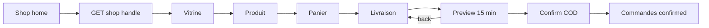

# Poro — Navigation et interactions

Conserve le graphe existant (`PoroNavHost.kt`, `Routes.kt`, `AppNav.kt`). Cette spec décrit les parcours, les gestes et les micro-interactions **à affiner visuellement**, pas un second NavHost.

## 1. Principes

1. Un seul `NavHost` typé.
2. Cinq onglets, `saveState` / `restoreState` / `launchSingleTop` inchangés.
3. Barre visible **uniquement** sur les cinq racines.
4. Session : `Unknown` → spinner ; `SignedOut` hors auth/légal → `goToSignIn()` qui vide le graphe ; `SignedIn` → Home.
5. Pas de deep links tant que `SHARE_BASE_URL` + intent-filters manquent.
6. Pas d’onglet Notifications / Messages / Analytics.

## 2. Barre principale

```
Accueil    Rechercher    Publier    Boutique    Profil
 Home        Search     AddCircle     Store      Person
```

| Interaction | Comportement |
|---|---|
| Tap autre onglet | Restore pile de l’onglet |
| Re-tap Accueil | Refresh du kind courant (déjà) |
| Re-tap autres | Restaure le root si on est sur un enfant **ou** no-op si déjà root — **conserver** le `popUpTo` actuel |
| Enfant (vidéo, cart…) | Barre cachée, `BackTopBar` |
| Retour système sur root | Quitte l’app |

**Δ icône Boutique** : `Store` au lieu de `ShoppingCart`. Le panier reste un bouton **dans** l’accueil boutique et un badge.

Centre Publier : conserver `AddCircle`. Ne pas passer à un FAB au-dessus du fil (conflit overlay + accessibilité).

## 3. Arbre (inchangé + ajouts justifiés)

```
Loading
├─ SignedOut
│    Phone → OTP → Home
│    Phone → Email → Home
│           → Register → EmailVerify → Home
│           → Forgot → Reset → Email
│    Legal*  (accessible SignedOut, pas ejecté)
│
└─ SignedIn + barre si root
     Home → PublicProfile | Notifications → Prefs | Video | sheets
     Search → Video | PublicProfile
     Upload → Video
     ShopHome → Shop → Product → Cart → Checkout → Orders
              → Cart | Orders | MyShop → Editor | SellerOrders
     Profile → Edit | Settings → Prefs | Delete | Legal
             → EmailVerify | Video (mes vidéos)
```

**Ajouts sans nouvel onglet**

| Destination | Type | Depuis |
|---|---|---|
| `ReportSheet` | Sheet, pas de route | ⋮ fil, vidéo, commentaire, profil |
| `LegalRoute` / `LegalDocumentRoute` | Routes | Settings, pied auth |
| `FollowListRoute` | Route P1 | Compteurs profil |

## 4. Parcours critiques

### P-AUTH — Entrer

Phone ou email → jetons → Home, graphe recréé. Logout / delete / refresh mort → Phone, graphe recréé. Ne pas restaurer un Checkout d’une session précédente.

### P-FEED — Consommer

Home = le fil. Comments/Share/Report = sheets : le pager **reste dessous**, la page ne se démonte pas. Tap auteur = `PublicProfile` (barre cachée). Retour = fil à la même page (ViewModel onglet).

### P-SHOP — Acheter

Handle → vitrine → produit → panier → livraison → récap → commandes.



Interactions à ne pas casser :

- `BackHandler` récap → livraison, pas pop route.
- Preview expiré → nouvel aperçu, pas une commande fantôme.
- Confirm `working` : un tap.
- Après réseau confirm : retry / GET orders, pas « échec définitif ».

### P-SELL — Vendre

Shop home tuile Vendre → formulaire **ou** dashboard. Pays/devise une seule fois. Publish produit = photo obligatoire.

### P-REPORT — Signaler

⋮ → Signaler → sheet motifs → POST → dismiss + snackbar. Dismiss sheet = rien.

### P-LEGAL — Lire

Settings / auth → liste → document ou indisponible. Observer session : `Legal*` traité comme sign-in (pas d’éjection).

## 5. Gestes

| Surface | Geste | Effet | Interdit |
|---|---|---|---|
| Fil | Swipe vertical | Page suivante | Swipe like, double-tap like |
| Fil | Tap centre | Play / pause | Tap like |
| Overlay | Tap auteur | Profil | — |
| Overlay | Tap action | Like / comments / share / menu | Actions < 48 dp |
| Sheet | Drag down / tap scrim | Fermer | POST implicite |
| Checkout | Back | Étape précédente | Perte du form (`SavedStateHandle`) |
| Grille | Tap carte | Produit / vidéo | Long-press inventé sauf delete mes vidéos (déjà) |
| OTP | Autofill / tap case | Focus | — |

TalkBack : le pager vertical peut entrer en conflit avec le swipe d’accessibilité — **À confirmer sur appareil**. Si conflit : les boutons kind + actions suffisent, ne pas désactiver le pager.

## 6. Clavier

`windowSoftInputMode=adjustResize` déjà. Règles :

- Auth / checkout / composer commentaires : le CTA ou le champ actif reste visible.
- Search : IME Search déclenche la requête.
- Handle boutique : IME Search = find.
- Composer commentaires : `imePadding` déjà sur la sheet — conserver.

## 7. Feedback d’interaction

| Action | Feedback | Délai |
|---|---|---|
| Like | Teinte `#FF3B5C` + compteur immédiat | 0 ms (optimistic) ; erreur → snackbar revert |
| Follow | Bouton → « Abonné·e » outlined | Optimistic + revert |
| Add to cart | Snackbar `product_added` ; badge hub | Après 200 |
| Checkout confirm | Spinner CTA → snackbar `checkout_placed` → liste | Après 200 confirm |
| Upload | % sur carte statut | Parties S3 |
| Report 201 / 200 | Snackbar, sheet close | Après réponse |
| 429 | Countdown bouton | `Retry-After` |
| Erreur champ | supporting + liveRegion | Immédiat local ; serveur après submit |

Pas de haptic obligatoire (P2). Si ajouté : like et confirm seulement, respecter les réglages système.

## 8. Mode invité (après backend seulement)

Ne pas implémenter maintenant. Quand `GET /feed/trending` sera optionnel + quota IP :

1. Start `HomeRoute` sans jetons.
2. Accueil visiteur = **Tendances uniquement**.
3. Publier → challenge login.
4. Like / comment / follow / share / report / panier → login avec **`returnTo`**.
5. `goToSignIn()` actuel vide tout : le logout doit continuer à vider ; le challenge invité **ne doit pas** utiliser le même chemin sans argument.

Détail accès : [phase-2/03](../mobile-ux-phase-2/03-guest-mode-feasibility.md).

## 9. Notifications → navigation

`NotificationTarget` : video → `VideoRoute` ; user → `PublicProfileRoute` ; order + `role=seller` → `OrderRoute(asSeller=true)`.

Inconnu : rester sur la liste. Push OS : absent (Firebase).

## 10. Ce qu’il ne faut pas faire

- Second `NavigationBar` dans Boutique.
- Onglet Créateur / Vendeur (ce sont des états de profil).
- WebView à la place d’un écran.
- Deep link qui ouvre Wave.
- Routes `/moderation/cases` ou `/admin/shops`.
- « Confirmer la sortie » sur le fil.
