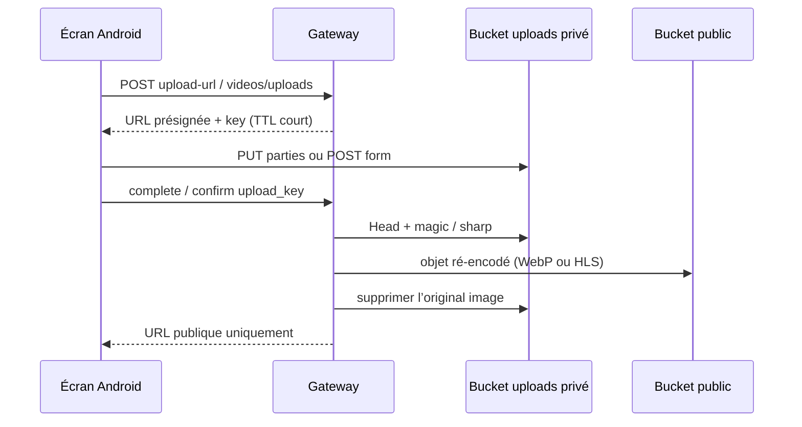

# Architecture et sécurité — médias clients

Conception seulement. Aucun changement de contrat.

## 1. Flux d’import (déjà en production)

Vidéo : l’original **reste** dans `poro-video-sources` (privé) pour le worker ; il n’est jamais renvoyé au client.

## 2. Règles client

1. **Ne jamais** logger `upload_url`, `fields`, `policy`, `upload_key`, `upload_id`, ETag complets, ni les query strings présignées.
2. Ne pas écrire ces valeurs dans `SavedStateHandle` au-delà de la session d’envoi en cours. L’URI `content://` du fichier choisi est acceptable (déjà pour la vidéo).
3. Après confirm, ne conserver que les URLs **publiques** des DTO (`hls_url`, `thumbnail_url`, `logo_url`, `images[].url`, `avatar_url`).
4. Ne pas construire une URL S3 à la main à partir de `user_id` / `video_id` (la source serait devinable mais **privée** ; ne pas tenter le GET).
5. Coil : cache disque des images publiques OK (déjà). Ne pas pointer Coil sur une URL présignée.
6. OkHttp `mediaClient` (uploads S3) : pas d’intercepteur Bearer. Le jeton n’appartient pas au stockage objet.

## 3. Mémoire et I/O

| Fichier | Lecture | Écriture galerie (si Q-MED-01) |
|---|---|---|
| Vidéo ≤ 256 Mio | Morceaux 8 Mio (`LocalMediaReader.read`) | N/A (bloqué) |
| Image ≤ 5 Mio | Buffer unique pour l’upload présigné | Stream GET → `ParcelFileDescriptor` MediaStore ; éviter un second `ByteArray` de 5 Mio si possible |
| HLS | ExoPlayer (fenêtre) | Interdit |

Ne pas `readBytes()` sur une vidéo. Ne pas décoder un bitmap 40 Mpx : s’appuyer sur le refus serveur + Coil `size`.

## 4. Cycle de vie

| Travail | Survit à la rotation | Survit à la mort du process | Mécanisme actuel |
|---|---|---|---|
| Publication vidéo | Oui (`UploadManager` + scope app) | **Non** | Coroutine ; copie « gardez ouvert » |
| Image produit / logo / avatar | Non (lié au VM) | Non | `working` |
| Enregistrer image | Non (cible) | Non | Coroutine VM |
| Lecture HLS | Pause `onStop` | Non | ExoPlayer |

WorkManager / `FOREGROUND_SERVICE_DATA_SYNC` : **non retenus** ici. Conditions pour les reconsidérer (hors phase) :

- décision produit d’enregistrer un futur MP4 de plusieurs dizaines de Mo ;
- **et** spike Android qui prouve un fichier unique public ;
- **et** lot 5 phase 2 déjà tranché pour l’upload.

Jusque-là, tout travail média est au premier plan applicatif.

## 5. Permissions — principe du moindre privilège

| Besoin | Permission | Quand |
|---|---|---|
| API + HLS + images Coil | `INTERNET` | Manifest (déjà) |
| Choisir photo/vidéo | Aucune | Photo Picker |
| Filmer / enregistrer le son | `CAMERA` / `RECORD_AUDIO` | **Ne pas ajouter** (pas de capture in-app) |
| Enregistrer une image API 24–28 | `WRITE_EXTERNAL_STORAGE` maxSdk 28 | Au tap Enregistrer seulement |
| Lire toute la galerie | `READ_MEDIA_*` | **Ne pas ajouter** |

`allowBackup=false` déjà : les URI et jetons ne partent pas dans une sauvegarde cloud.

## 6. Droits et « média protégé »

L’API n’a pas de licence, watermark, ni `allow_download`. Un objet dans un bucket public est GET-able sans JWT.

Conséquences :

- On n’invente pas un cadenas « contenu protégé » sur une vidéo `ready`.
- On n’enregistre pas ce qui n’a plus d’URL (`removed`, quarantaine, non prêt).
- On n’utilise pas le player comme source d’un export (dump de cache ExoPlayer) : ce serait un contournement non spécifié, proche d’un original, et non vérifié.

Q-MED-02 (juridique) : les textes TOS devront dire si l’enregistrement d’une photo produit / d’une miniature est autorisé. Tant que Q-03 légal est ouvert, **ne pas activer** Q-MED-01 par défaut.

## 7. Intégrité des types

Toujours faire confiance, dans l’ordre :

1. Filtre Photo Picker (`ImageOnly` / `VideoOnly`)
2. MIME + taille + durée **locaux**
3. Enum OpenAPI à l’init (`content_type`)
4. Vérification serveur (magic bytes / sharp)

Le client ne « répare » pas un HEIC en le renommant `image/jpeg`.

## 8. Surfaces d’attaque à ne pas ouvrir

- WebView qui charge une URL média utilisateur.
- Intent `file://` ou partage du cache interne.
- Exposer SeaweedFS hors de la gateway dans un build release.
- Réutiliser une policy présignée après expiration ou pour un autre `content_type`.

## 9. Tests d’architecture (quand le code sera autorisé)

- ViewModel : refus HEIC / 5 Mio+1 / 11ᵉ photo **sans** appel réseau.
- Upload vidéo : `read` appelé par morceaux (déjà `UploadManagerTest` / uploader).
- Save (si Q-MED-01) : une seule insertion MediaStore ; second tap no-op ; 404 → Unavailable sans retry automatique.
- Aucun test ne doit imprimer une URL présignée.
