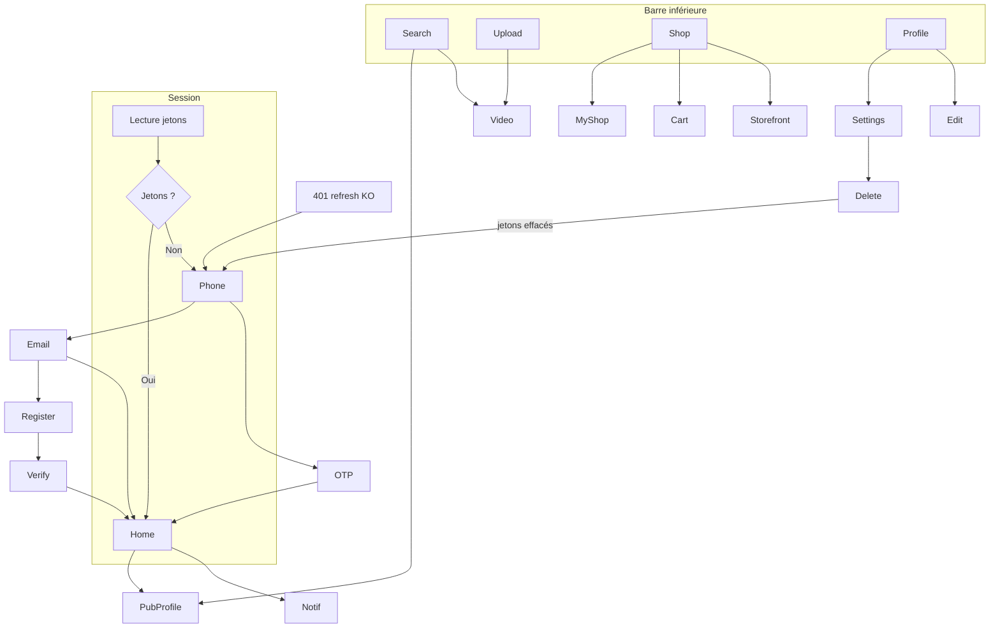

# Architecture de navigation mobile

Proposition fondée sur **la navigation déjà implémentée** dans `PoroNavHost.kt` et `Routes.kt`. Objectif : la conserver, la documenter, et n’ajouter une destination que si une fonctionnalité vérifiée l’exige.

## 1. Principes constatés

- Navigation Compose **typée** (`@Serializable`), un seul `NavHost`.
- Cinq onglets inférieurs, visibles **uniquement** sur leurs cinq routes racines.
- `saveState` / `restoreState` / `launchSingleTop` : un onglet conserve sa pile et son scroll.
- Gating : start destination figée (Home si jetons, sinon Phone) + observateur `SignedOut` → `goToSignIn()` qui **vide** le graphe.
- `EmailVerifyRoute` est authentifié, pas un écran de sign-in.
- Pas de deep links, pas d’App Links, pas de `VIEW` intent.
- `enableEdgeToEdge()` dans `MainActivity` ; insets : Scaffold activité + `WindowInsets(0)` sur le NavHost (les barres système sont gérées au niveau activité).
- Retour Android : pop NavHost, sauf checkout récap → retour livraison.

## 2. Navigation principale (à conserver)

Cinq onglets, de gauche à droite :

| Onglet | Route | Valeur |
|---|---|---|
| Accueil | `HomeRoute` | Consommation vidéo, cœur du produit |
| Rechercher | `SearchRoute` | Découverte comptes / hashtags / vidéos |
| Publier | `UploadRoute` | Création (centre, icône `AddCircle`) |
| Boutique | `ShopHomeRoute` | Marketplace — **en tension avec ADR-0004 P1** (Q-01) |
| Profil | `ProfileRoute` | Identité, vidéos, paramètres |

**Recommandation (pas un fait)** : ne pas ajouter d’onglet Notifications, Messages ou Live. Les notifications ont déjà une cloche sur le fil. Le chat n’existe pas. Un 6e onglet dégraderait la densité tactile et la lisibilité.

Si le lancement public **exclut** la marketplace : retirer l’onglet Boutique (et seulement lui) jusqu’au P1, sans créer un second graphe.

## 3. Arborescence

```
(Splash LoadingScreen)
│
├─ non connecté
│  PhoneRoute
│   ├─ OtpRoute
│   └─ EmailLoginRoute
│        ├─ EmailRegisterRoute → EmailVerifyRoute* → Home
│        ├─ ForgotPasswordRoute → ResetPasswordRoute → EmailLogin
│        └─ PhoneRoute
│
└─ connecté (barre si racine d’onglet)
   HomeRoute
   │  ├─ PublicProfileRoute
   │  ├─ (CommentsSheet, ShareSheet)
   │  ├─ NotificationsRoute → NotificationPreferencesRoute
   │  │                        └─ OrderRoute
   │  │                        └─ VideoRoute / PublicProfileRoute
   │  └─ VideoRoute (rare depuis le fil : le fil est l’écran)
   SearchRoute → VideoRoute | PublicProfileRoute
   UploadRoute → VideoRoute (après succès)
   ShopHomeRoute
   │  ├─ ShopRoute → ProductRoute → CartRoute → CheckoutRoute → OrdersRoute
   │  ├─ CartRoute
   │  ├─ OrdersRoute → OrderRoute
   │  └─ MyShopRoute → ProductEditorRoute
   │                 └─ OrdersRoute(asSeller)
   ProfileRoute
      ├─ EditProfileRoute
      ├─ SettingsRoute → NotificationPreferencesRoute
      │                └─ DeleteAccountRoute → (sign-out)
      ├─ EmailVerifyRoute
      ├─ VideoRoute (mes vidéos)
      └─ PublicProfileRoute (n/a moi)
```

\* EmailVerify après register est authentifié.

**À ajouter sans casser l’arbre**

- `ReportRoute` ou sheet depuis Feed / Video / Comments / PublicProfile (UI-MOD-001).
- `FollowListRoute(userId, kind)` depuis profils (UI-SOC-004).
- `LegalRoute` depuis Paramètres et éventuellement l’inscription (UI-LEG-001).

## 4. Diagramme des onglets et sessions



## 5. Destinations et transitions

| Destination | Auth | Entrées | Sorties principales |
|---|---|---|---|
| PhoneRoute | Non | Start, logout, session morte, delete | OTP, Email |
| OtpRoute | Non | Phone | Home, Phone |
| Email* | Non sauf Verify | Phone / Login | Home / Login |
| HomeRoute | Oui | Login, onglet | Profils, notif, sheets |
| SearchRoute | Oui | Onglet | Video, profil |
| UploadRoute | Oui | Onglet | Video |
| ShopHomeRoute | Oui | Onglet | Shop, cart, orders, my shop |
| ShopRoute / ProductRoute | Oui* | Handle, produit | Cart |
| Cart / Checkout | Oui | Shop home, produit | Orders |
| Orders / Order | Oui | Shop, notif | — |
| MyShop / Editor | Oui | Shop home | — |
| Profile / Edit / Settings / Delete | Oui | Onglet | — |
| Notifications / Prefs | Oui | Cloche, settings | Cibles |
| PublicProfile | Oui | Auteur, search, notif | Follow |
| VideoRoute | Oui | Search, notif, upload, mes vidéos | Profil auteur |

\* Le backend autorise GET boutique/produit/vidéo sans JWT. Android impose la session. **Recommandation** : garder le gating actuel pour le MVP (pas de double graphe visiteur) sauf décision Q-02 (liens de partage).

## 6. Navigation secondaire

- **Profils** : overlay auteur → PublicProfile ; moi = onglet Profil (pas PublicProfile).
- **Vidéo → commentaires** : ModalBottomSheet, pas une destination — le pager reste dessous.
- **Création** : onglet dédié, pas un FAB flottant par-dessus le fil (déjà le cas).
- **Marketplace** : tout part de ShopHome (pas de deep link produit).
- **Paramètres** : uniquement depuis Profil.

## 7. Bouton retour Android

| Contexte | Comportement à conserver |
|---|---|
| Racine d’onglet | Quitter l’app (back stack start) |
| Écran secondaire | `AppNav.back()` / `BackTopBar` |
| Checkout récap | Revenir à la livraison, ne pas pop la route |
| Bottom sheet | Fermer la feuille, pas la vidéo |
| Dialogue confirmation | Dismiss = annuler l’action destructive |

Ne pas intercepter le retour pour « confirmer la sortie » du fil.

## 8. Liens profonds

**Aucun aujourd’hui.** Pattern prévu côté share : `{SHARE_BASE_URL}/v/{videoId}` (`Sharing.kt`). Tant que l’URL publique et les intent-filters manquent, un lien collé n’ouvre pas l’app.

**Spécification future (recommandation, pas implémentée)**

| Lien | Destination | Auth |
|---|---|---|
| `/v/{videoId}` | `VideoRoute` | Si Q-02 = visiteur : lecteur public ; sinon : login puis vidéo |
| `/u/{username}` | `PublicProfileRoute` | Idem |
| `/s/{handle}` | `ShopRoute` | Idem |
| `/o/{orderId}` | `OrderRoute` | Toujours authentifié |

Gérer l’expiration / 404 par les états déjà prévus (`error_not_found`, `video_removed`).

## 9. État à préserver

| État | Mécanisme actuel | Règle |
|---|---|---|
| Pile par onglet | `saveState` / `restoreState` | Ne pas `popUpTo` inclusif en changeant d’onglet |
| Page du pager / kind de feed | ViewModel onglet (durée de vie back stack) | Un re-tap refresh volontaire |
| Session For You Redis | Côté serveur 30 min | Un curseur périmé relance une session (FeedViewModel gère `invalid_cursor`) |
| Panier | Serveur | Recharger à l’entrée Cart |
| Preview checkout | Serveur 15 min | Expiré → nouvel aperçu, pas une commande |
| Formulaire checkout | `SavedStateHandle` | Survie à la rotation |
| Jetons | DataStore chiffré | Survie process ; pas de backup (`allowBackup=false`) |

Après login : Home, graphe recréé. Après logout / delete / revoke global : Phone, graphe recréé. Ne pas restaurer Shop/Checkout d’une session précédente.

## 10. Notifications → navigation

`NotificationTarget.kt` : video → `VideoRoute` ; user → `PublicProfileRoute` ; order + `role=seller` → `OrderRoute(..., asSeller=true)`. Cible inconnue : ouvrir la liste seulement.

Enregistrement FCM absent : pas de tap notification OS.

## 11. Ce qu’il ne faut pas faire

- Remplacer NavHost par une WebView.
- Introduire un second bottom bar (ex. dans Boutique).
- Dupliquer un design system de navigation Material différent.
- Ajouter un onglet « Créateur » ou « Enterprise » : ce sont des états de profil, pas des espaces racine.
- Brancher les routes admin `/moderation/cases` dans l’app grand public.
