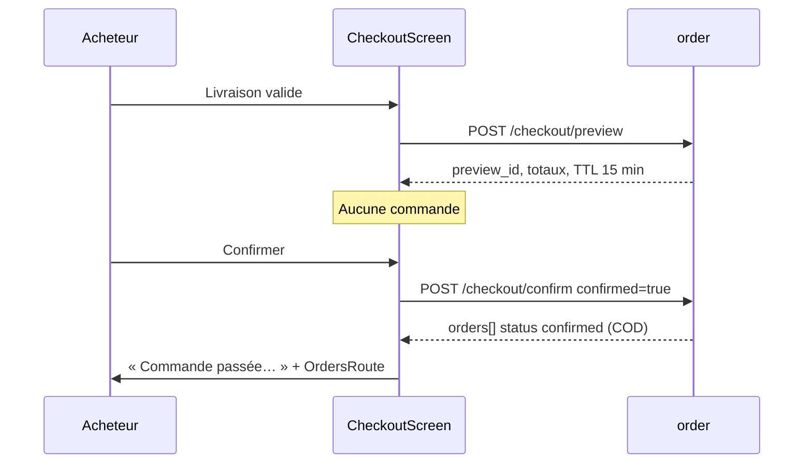

# Axe A — Diagnostic marketplace

Périmètre : parcours **déjà codés** dans `ui/shop/` et APIs `docs/api/shop.openapi.yaml`, `docs/api/order.openapi.yaml`. Pas de Mobile Money, pas de recherche catalogue.

## 1. Découverte des boutiques

| | |
|---|---|
| Écran | `ShopHomeScreen` / `ShopHomeRoute` |
| Composants | Champ `@handle`, `SubmitButton`, badge panier, CTA commandes, CTA ma boutique |
| API | `GET /api/v1/shops/{handle}` (public) ; `GET /cart` et `GET /shops/me` au `refresh()` |
| Validation | Handle ≥ 3 après retrait de `@`, max 31 dans le champ |
| Vide | Pas de catalogue : copie `shop_find_hint` |
| Erreur | 404 → `shop_not_found` ; réseau → `error_network` |
| Retry | Resoumettre ; `finding` empêche le double tap |
| Lacune | Aucune liste, catégorie, ni search (PORO-026). **Ne pas inventer d’écran résultats.** |

**Risque** : `GET /shops/me` et `GET /cart` échouent silencieusement (`hasShop` reste null, badge 0). L’accueil reste utilisable.

## 2. Vitrine

| | |
|---|---|
| Écran | `ShopScreen` / `ShopRoute(handle)` |
| API | `GET /shops/{handle}` ; `GET /shops/{handle}/products?cursor&limit` |
| États | `Loadable` shop + liste produits ; vide `shop_no_products` ; load more |
| Données | Nom, logo, description, `ProductCard` (prix « À partir de ») |
| Boutique `closed` / `suspended` | 404 public : l’acheteur voit « introuvable », pas le motif. **Conserver** (pas d’énumération). |
| Retour | `BackTopBar` |

## 3. Fiche produit

| | |
|---|---|
| Écran | `ProductScreen` / `ProductRoute` |
| API lecture | `GET /products/{productId}` (public, publié + boutique active) |
| API écriture | `PUT /cart/items/{variantId}` `{quantity}` **valeur absolue 1–99** |
| Actions | Variante, stepper 1–99, ajouter, ouvrir boutique |
| Double soumission | `adding` / `canAdd` |
| Succès | Snackbar `product_added` |

**Incohérence** : `addToCart()` envoie `setQuantity(variantId, quantity)` = **remplace** la quantité panier, n’additionne pas. Deux ajouts « 1 » laissent 1 en panier. À corriger en relisant le panier puis en saturant à 99, **sans nouvel endpoint**.

Rupture : `inStock` est un indice ; le checkout réserve vraiment.

## 4. Panier

| | |
|---|---|
| Écran | `CartScreen` / `CartRoute` |
| API | `GET /cart` ; `PUT /cart/items/{id}` ; `DELETE /cart/items/{id}` |
| Quantité | 1–99 ; qty &lt; 1 → `remove` |
| `canCheckout` | Au moins une boutique **et** `unavailable` vide **et** aucune ligne `busy` |
| État serveur | Panier authentifié, survit au changement d’écran et de process |
| `DELETE /cart` | API sans UI (vider d’un coup) — P2, pas bloquant |
| Notice | `cart_payment_notice` : « Paiement à la livraison. Une commande est créée par boutique. » — **honnête** |

Retour : `LaunchedEffect` recharge le panier (prix live).

## 5. Checkout — deux étapes distinctes

Ne pas fusionner preview et confirm. Ne jamais afficher « Payé ».

| Étape | API | Effet réel | Copie UI actuelle |
|---|---|---|---|
| Prefill | `GET /checkout/prefill` + `GET /addresses` | Aucune commande | Formulaire |
| Preview | `POST /checkout/preview` | Recap 15 min ; `save_address` optionnel | Étape 2 |
| Confirm | `POST /checkout/confirm` `{preview_id, confirmed:true}` | **Création** : une commande / boutique, stock réservé, COD → `confirmed` | `checkout_placed` |
| Paiement | Aucun appel | `paid: false` | Label COD, pas « payé » |

`payment_method` Android : non envoyé (défaut serveur `cash_on_delivery`). Wave dans l’enum OpenAPI : **non proposé**.

**Anti double submit** : `working` sur preview et confirm.

**Idempotence confirm** (contrat) : même `preview_id` renvoie les mêmes commandes. En cas d’erreur réseau après tap : **ne pas** afficher un échec définitif ; réessayer confirm **ou** `GET /orders`. Risque actuel : `NetworkError` laisse l’utilisateur sur le récap — acceptable si un second tap rejoue l’idempotence. Si le preview a été consommé autrement → `preview_not_found` → retour livraison avec `checkout_preview_outdated`.

**Stale** : `preview_outdated` / `expired` / `not_found` → `preview = null`, nouvel aperçu obligatoire.

**Back** : `BackHandler` récap → livraison (`edit()`), formulaire `SavedStateHandle`.

**GPS** : contrat optionnel ; Android n’envoie pas `location`. Suffisant si adresse texte (validation `isValid`).

## 6. Commandes acheteur

| | |
|---|---|
| Liste | `GET /orders` — `OrdersRoute(asSeller=false)` |
| Détail | `GET /orders/{id}` |
| Annuler | `POST .../cancel` si `cancellable` (pending, awaiting_payment, confirmed, paid) + dialogue |
| Réception | `POST .../confirm-receipt` si `shipped` |
| Completed auto | 7 jours après ship (serveur), sans UI timer |

`awaiting_payment` / `paid` : labels existent. **COD ne produit pas ces statuts.** Si affichés, c’est un autre moyen — aujourd’hui ne doit pas arriver. Ne pas retirer les strings (contrat) ; ne pas les utiliser comme succès COD.

`order.paid` booléen : pour COD rester `false`. L’UI ne s’en sert pas pour un badge « Payée » hors `status == paid`. **Conserver cette discipline.**

## 7. Commandes vendeur

| | |
|---|---|
| Liste | `GET /seller/orders` — depuis `MyShopScreen` |
| Détail | `GET /seller/orders/{id}` (contact livraison) |
| Expédier | `POST .../ship` `{tracking?}` si `confirmed` ou `paid` |
| Annuler | `POST /seller/orders/{id}/cancel` tant que non shipped |
| Contact | Visible après commande ; effacé 90 j après fin (ADR-0012) |

Pas de litige / retour (PORO-036). Pas d’annulation post-expédition.

Double submit : `working` sur `OrderViewModel.act`.

## 8. Ma boutique et catalogue vendeur

| Action | API | UI | Notes |
|---|---|---|---|
| Ouvrir | `POST /shops` | Formulaire pays définitif | 409 `shop_exists` / `handle_taken` |
| Lire / patch | `GET/PATCH /shops/me` | Dashboard | |
| Fermer / rouvrir | `POST .../close` `/reopen` | | 409 `shop_status_conflict` |
| Logo | upload-url + PUT | Picker | **DELETE logo API sans UI** |
| Produits | CRUD `/shops/me/products` | `ProductEditorScreen` | Titre 1–120, desc ≤2000, ≤50 variantes |
| Photos | max **10** API | UI limite **8** | Écart à aligner sur 10 |
| Publier | status `active` | Exige photo serveur | `image_required` |
| Stock | `PUT .../stock` | Champ variante | `stock_below_reserved` |
| Suspendue | 403 `shop_suspended` | Message | Pas d’admin dans l’app |

## 9. Matrice écran → action → API → résultat → erreurs → AC

| ID | Écran | Action | API | Succès | Erreurs | AC |
|---|---|---|---|---|---|---|
| MX-01 | Shop home | Trouver | `GET /shops/{handle}` | `ShopRoute` | 404, réseau, handle &lt; 3 | Handle actif ouvre la grille |
| MX-02 | Vitrine | Charger / plus | GET shop + products | Cartes | 404, réseau | Loadable retry |
| MX-03 | Produit | Ajouter | `PUT /cart/items/{vid}` | Snackbar | `own_shop`, `variant_unavailable`, `cart_full` | Compteur panier à jour |
| MX-04 | Produit | Qty | État local 1–99 | — | — | Min 1 max 99 |
| MX-05 | Panier | Qty / retirer | PUT / DELETE item | Panier renvoyé | unavailable, réseau | `busy` anti double |
| MX-06 | Panier | Commander | nav Checkout | — | CTA off si unavailable | `canCheckout` |
| MX-07 | Checkout | Continuer | `POST /preview` | Recap | `delivery_invalid`, `cart_empty`, `cart_unavailable` | Aucune commande en base |
| MX-08 | Checkout | Confirmer | `POST /confirm` | `confirmed` + snackbar `checkout_placed` | stale, `payment_unavailable`, réseau | **Pas** de libellé Payée ; liste commandes |
| MX-09 | Checkout | Back récap | `edit()` | Formulaire | — | Preview annulé localement |
| MX-10 | Orders | Lister | GET /orders | Page | réseau | Vide `orders_empty` |
| MX-11 | Order | Annuler | POST cancel | `cancelled` | `order_status_conflict` | Dialogue d’abord |
| MX-12 | Order | Reçu | POST confirm-receipt | `completed` | conflict | Uniquement si shipped |
| MX-13 | Seller order | Ship | POST ship | `shipped` | tracking_invalid, conflict | Tracking facultatif ≤200 |
| MX-14 | My shop | Ouvrir | POST /shops | Dashboard | handle_*, shop_exists | Pays/devise figés ensuite |
| MX-15 | Editor | Publier | PATCH status active | En vente | `image_required` | Photo obligatoire |
| MX-16 | Editor | Supprimer | DELETE product | Retour liste | `has_reservations` | Dialogue |

## 10. Messages vs backend

| Copie | Honnête ? | Action |
|---|---|---|
| `checkout_placed` | Oui | Conserver |
| `payment_cash_on_delivery` | Oui | Conserver ; ignorer Wave |
| `order_status_confirmed` | Oui pour COD après confirm | Statut attendu |
| `order_status_paid` | Seulement si `status=paid` | Ne jamais forcer après COD |
| `order_status_pending` | Court (réservation stock) | Afficher si reçu |
| `product_added` | Oui si 200 panier | Conserver ; corriger add vs set |
| `shop_status_suspended` | Oui vendeur | Conserver |

## 11. Correctifs de stabilisation (spec, pas encore code)

1. Additionner au panier au lieu d’écraser (`GET /cart` puis PUT somme bornée 99).
2. Aligner max photos 8 → 10.
3. Après `NetworkError` sur confirm : message « Vérification… » + `GET /orders` ou retry idempotent, pas « échec » seul.
4. Préfill / addresses en échec : formulaire vide + erreur retry, aujourd’hui souvent ignoré (`as? Success`).
5. `hasShop` réseau : ne pas afficher « Ouvrir » par défaut erroné (`null` ≠ `false`).
6. Accessibilité : icône panier `contentDescription=null` alors que le texte voisin existe — acceptable ; badge chiffre à annoncer.

Hors scope : Wave, GPS, vider le panier d’un coup, DELETE logo, search catalogue.
