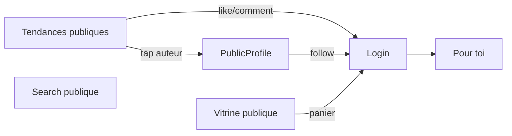

# Axe B — Faisabilité du mode invité

Décision produit : consulter un **fil public** sans compte, puis demander une connexion pour une action protégée. Cette note vérifie le contrat réel. **Aucun changement backend ni Android n’est fait ici.**

## 1. Verdict

| Objectif | Verdict | Raison |
|---|---|---|
| Lire une vidéo `ready` par id, HLS, miniature | **Faisable maintenant** | `GET /videos/{id}` `OptionalMiddleware` ; bucket `poro-videos` lecture GET publique (ADR-0015) |
| Profil public, boutique, produit, recherche | **Faisable maintenant** | `security: []` ou JWT optionnel |
| Fil Accueil (Pour toi / Abonnements / Tendances) | **Bloqué** | Les trois routes sont derrière `jwtauth.Middleware` obligatoire (`services/feed/internal/routes/routes.go`) |
| Panier, checkout, like, commenter, follow, publier, signaler, notif | **Auth obligatoire** | 401 sans Bearer |
| Activer l’invité en retirant seulement l’écran login | **Interdit** | `/feed/*` répondrait 401 ; For You n’a pas de sens sans `sub` |

Le mode invité **ne doit pas être implémenté dans l’app** tant que le fil public n’a pas de route. Sinon l’onglet Accueil est un écran d’erreur.

## 2. Gateway

Traefik route `/api/v1/{domaine}` sans JWT (`infra/gateway/routes.yml`). L’auth est **dans chaque service**. Rendre une route publique = changer le service, pas la gateway. Cette phase ne le fait pas.

## 3. Matrice d’accès (contrat actuel)

Légende : **Pub** = sans JWT ; **Opt** = JWT optionnel (token invalide → 401) ; **Auth** = Bearer requis ; **Staff** = `ADMIN`/`MODERATOR` ; **Own** = propriétaire / `seller_id`.

| Surface | Visiteur | Connecté | Propriétaire | Staff |
|---|---|---|---|---|
| `GET /feed/for-you` | 401 | Oui (jamais ses vidéos) | n/a | Comme connecté |
| `GET /feed/following` | 401 | Oui | n/a | idem |
| `GET /feed/trending` | **401** | Oui (algo **sans** `userId`) | n/a | idem |
| `GET /videos/{id}` ready+approved | Pub | Pub | Autres statuts | — |
| `GET /videos/{id}` processing/failed/removed | 404 | 404 | 200 (removed sans médias) | — |
| `GET /videos` liste | 401 | Ses vidéos | — | — |
| HLS `master.m3u8` | GET public si URL connue | idem | sources privées | — |
| `GET /search`, `/search/suggest` | Pub (quota IP) | Quota compte | — | — |
| `GET /users/by-username/{u}` | Pub (pas de téléphone/email/pays) | Pub | `GET /users/me` champs privés | — |
| Stats/comments/likes GET | Opt | Opt (`liked_by_me` si JWT) | — | — |
| Like, comment, follow, share, report | 401 | Oui | — | File cases 403 sinon |
| `GET /shops/{handle}` active | Pub | Pub | `GET /shops/me` | suspend/reinstate |
| `GET /products/{id}` publié | Pub | Pub | CRUD me | — |
| Panier, checkout, orders | 401 | Oui | Seller routes si `seller_id` | — |
| Upload, settings, delete account | 401 | Oui | — | — |

Staff : mêmes routes publiques + `/moderation/cases*` et `/admin/shops/*`. **Ne pas** les exposer dans l’app grand public (visiteur ou membre).

## 4. Feed : ce que le code fait vraiment

```37:50:services/feed/internal/handler/handler.go
func (h *Feed) Trending(c *fiber.Ctx) error {
	return h.serve(c, func(ctx context.Context, _ uuid.UUID, cursor string, limit int) (*dto.Page, error) {
		return h.svc.Trending(ctx, cursor, limit)
	})
}
func (h *Feed) serve(c *fiber.Ctx, fn feedFunc) error {
	claims, ok := jwtauth.ClaimsFrom(c)
	if !ok {
		return errUnauthorized
	}
```

- **Tendances** : n’utilise pas le viewer. Le JWT ne sert qu’à l’auth et au rate limit « par user ».
- **Pour toi** : session Redis 200 ids, mix follows — **identité obligatoire**.
- **Abonnements** : follows — **identité obligatoire**.
- Pagination : curseur opaque ; invité n’a pas de session For You aujourd’hui.
- Items : pas d’email, pas de téléphone ; `author` public.

## 5. HLS et données personnelles

- HLS / thumbs : bucket public GET/HEAD, pas de listing (ADR-0015). Une URL connue est lisible sans compte — déjà le cas pour un connecté qui partage un lien fichier.
- Originaux : bucket privé. Invité ne doit jamais recevoir d’URL `source`.
- Profil public : pas de `country_code`. Ne pas appeler `GET /auth/me` ni `GET /users/me` sans session.
- Commandes / adresses / sessions : jamais en visiteur.
- Token optionnel mal formé : **401** (search, video, social GET). Client invité : **n’envoyer aucun Authorization**. `AuthInterceptor` et `TokenAuthenticator` le permettent déjà (`access == null` → pas de header ; 401 anonyme → pas de refresh).

## 6. Rate limit et abus

| Route publique | Limite actuelle |
|---|---|
| Search | 60/min / compte **ou IP** |
| Video GET | 60/min général (storage Redis) |
| Shop public | 120/min |
| Feed | 120/min **par user** — inutilisable anonyme |

Ouvrir Tendances sans JWT impose un quota **par IP** (comme search). Sinon scraping trivial. À spécifier dans une ADR feed **avant** implémentation.

Modération : contenus `removed` déjà exclus du feed et 404 public. Un visiteur ne signale pas (401) → CTA login.

## 7. Expérience visiteur proposée (après déblocage)

Ne pas construire un second graphe. Étendre `PoroNavHost` :

1. Start : `HomeRoute` même sans jetons (aujourd’hui `PhoneRoute` si `SignedOut`).
2. Onglets visiteur : **Accueil, Rechercher, Boutique, Profil**. **Publier** → écran login (pas d’upload anonyme).
3. Accueil visiteur : **uniquement Tendances** (Pour toi / Abonnements : CTA « Connectez-vous pour un fil personnel »). Impossible tant que trending est 401.
4. Overlay like / comment / follow / share / report / panier / checkout / ma boutique → `goToSignIn()` avec **retour** vers l’écran d’origine après succès (aujourd’hui login `popUpTo` graphe entier → Home). Prévoir `returnTo` **sans** casser le logout actuel.
5. Boutique : vitrine et fiche **lisibles** ; Ajouter au panier → login.
6. Profil onglet : « Connectez-vous » + liens légaux, pas `GET /users/me`.



## 8. Changements backend **nécessaires** (non faits)

Pour honorer « fil public » sans affaiblir Pour toi :

1. `GET /api/v1/feed/trending` : `OptionalMiddleware` (ou pas de JWT).
2. Rate limit anonyme par IP, même ordre de grandeur que search (60/min) + plafond gateway existant.
3. OpenAPI feed : `security` optionnel sur trending seulement ; For You / Following restent Bearer.
4. Tests : trending 200 sans header ; For You 401 sans header ; token pourri → 401 (ne pas ignorer un Bearer invalide).
5. ADR court (complément 0009) : trending = surface publique, pas de PII, pas de vidéos non `ready`/`approved`.

**Sans ces points, le mode invité est bloqué.** Une implémentation Android seule serait une régression (Accueil en erreur).

Hors besoin pour l’invité : rendre Pour toi ou Following publics (incorrect métier).

## 9. Sécurité — ce que le client ne doit pas faire

- Ne pas inventer un rôle `GUEST` dans le JWT.
- Ne pas cacher un bouton comme substitut d’un 401.
- Ne pas stocker un « faux token ».
- Ne pas logger les identifiants saisis au challenge login.
- Ne pas précharger le panier / `/auth/me` en visiteur.
- Ne pas brancher les routes staff.

## 10. Android concerné (plus tard seulement)

`PoroNavHost.kt` (start + tabs), `FeedScreen` / `FeedViewModel` (kind visiteur), `AuthInterceptor` (déjà OK), graphes shop/social (gates), `AppNav.goToSignIn` (returnTo). **Interdit dans cette phase.**
