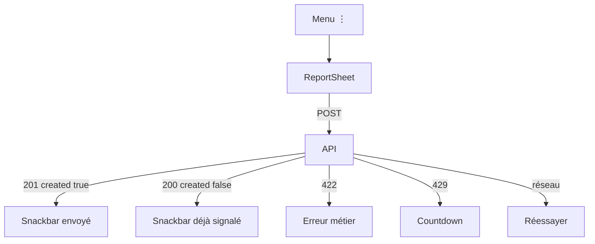

# Axe C — Spécification du signalement

Contrat unique : `POST /api/v1/moderation/reports` (`docs/api/moderation.openapi.yaml`). Motifs, cibles et réponses ci-dessous sont **exactement** ceux du contrat. File staff hors app.

## 1. Objectif

Permettre à un **compte authentifié** de signaler une vidéo, un commentaire ou un profil, sans promettre de délai de traitement (Q-15).

## 2. Contrat

| Champ | Règle |
|---|---|
| Auth | Bearer obligatoire. Visiteur → login puis retour. |
| Corps | `{target_type, target_id, reason, comment?}` `additionalProperties: false` |
| `target_type` | `video` \| `comment` \| `user` **seulement** (pas produit, pas boutique) |
| `target_id` | UUID |
| `reason` | `spam` \| `nudity` \| `violence` \| `harassment` \| `hate` \| `fraud` \| `other` |
| `comment` | string ou null, **max 500**, facultatif |
| Succès nouveau | **201** `{report_id, case_id, created: true}` |
| Doublon même compte + même cible | **200** `{…, created: false}` (renvoie le premier) |
| Auto-signalement | **422** `cannot_report_self` |
| Quota | 10 reports / heure / compte, 120 req/min → **429** `Retry-After` |
| Invalide | 400 `invalid_request` / `invalid_json` |
| 401 / 503 | session / indisponible |

Ne pas afficher `case_id` ni `report_id` à l’utilisateur (interne). Ne pas inventer de statut « en revue ».

## 3. Points d’entrée (natifs, pas de nouvelle tab)

| Cible | Entrée | `target_type` / id |
|---|---|---|
| Vidéo | Menu ⋮ overlay fil + `VideoScreen` | `video` / `videoId` |
| Commentaire | ⋮ sur la ligne (pas le propriétaire du commentaire pour lui-même si 422) | `comment` / `commentId` |
| Profil | ⋮ `PublicProfileScreen` | `user` / `userId` |

Pas d’entrée depuis fiche produit / boutique (API refusera tout autre type). Signalement vendeur frauduleux : motif `fraud` **sur le profil** (`user`), pas sur le produit.

Composant nouveau justifié : `OverflowMenu` + `ReportSheet` (bottom sheet), voir [06](06-design-system-extension.md).

## 4. Parcours

1. Tap ⋮ → action « Signaler » (48 dp, TalkBack).
2. Si `SignedOut` → login avec retour (quand le mode invité existera ; aujourd’hui l’app est déjà connectée).
3. Ouvrir `ReportSheet` : liste de 7 motifs (libellés FR ci-dessous), champ détail facultatif 500, compteur, CTA.
4. CTA inactif tant que motif non choisi ou `submitting`.
5. `POST` ; spinner sur le bouton (`SubmitButton` existant).
6. **201** : fermer + snackbar « Signalement envoyé. Notre équipe va l’examiner. » (sans délai).
7. **200 `created: false`** : même snackbar **ou** « Vous avez déjà signalé ce contenu. » — recommandé : phrase dédiée, pas une erreur.
8. 422 self : « Vous ne pouvez pas signaler votre propre contenu. »
9. 429 : countdown `Retry-After` comme l’auth.
10. Réseau / 503 : message + Réessayer dans la sheet (ne pas perdre le motif).

Annulation : dismiss sheet = aucun POST.

## 5. Libellés motifs (UI seulement)

Les **valeurs envoyées** restent l’enum anglais. Textes FR à mettre dans `strings.xml` lors de l’implémentation :

| Valeur API | Libellé proposé |
|---|---|
| `spam` | Spam ou publicité indésirable |
| `nudity` | Nudité ou contenu sexuel |
| `violence` | Violence ou danger |
| `harassment` | Harcèlement |
| `hate` | Haine ou discrimination |
| `fraud` | Arnaque ou fraude |
| `other` | Autre |

Ne pas ajouter « propriété intellectuelle », « mineur », etc. sans étendre l’OpenAPI.

## 6. États UI

| État | Affichage |
|---|---|
| Initial | Motifs, détail vide, CTA off |
| Motif choisi | CTA on |
| Détail &gt; 500 | Bloquer saisie / erreur locale (éviter 400) |
| Submitting | CTA loading, champs enabled=false |
| Succès | Sheet dismiss |
| Doublon | Dismiss + snackbar dédié |
| Erreur métier / réseau | Texte `ErrorMessageText` dans la sheet |
| Rate limit | `SubmitButton` countdown |

Pas d’état « vide ». Pas d’historique des signalements (API absente).

## 7. Mapping erreurs

Étendre `toErrorMessage()` / `ApiErrorCodes` :

| Code | String |
|---|---|
| `cannot_report_self` | Nouvelle |
| `rate_limited` | Existante |
| `unauthorized` | Session → login |
| `unavailable` | Existante |
| `invalid_request` | Existante |

`created` n’est pas une erreur.

## 8. Sécurité et accessibilité

- Droits : le serveur refuse self et impose le quota ; masquer ⋮ sur **son** overlay n’est pas une autorisation (on peut quand même ouvrir un profil / une vidéo à soi via un autre chemin).
- Ne pas préremplir le détail avec le titre de la vidéo (PII / preuve inutile).
- TalkBack : sheet titre « Signaler », motifs `Role.RadioButton` ou liste sélectionnable, CTA nommé.
- minSdk 24 : `ModalBottomSheet` M3 déjà utilisé (`CommentsSheet`).

## 9. Fichiers Android **futurs** (non créés)

`ui/moderation/ReportSheet.kt`, `ReportViewModel.kt`, `data/moderation/ModerationApi.kt` ; points d’accroche `SocialVideoActions`, `CommentsSheet`, `PublicProfileScreen` ; strings. Navigation : **pas de route** (sheet), compatible avec le graphe actuel.

## 10. Critères d’acceptation

Voir AC-MOD dans [08](08-acceptance-tests.md). Résumé : un motif du contrat part ; un motif hors enum est impossible ; doublon 200 n’affiche pas une erreur rouge ; self 422 ; 11e report / heure 429 ; visiteur ne POST pas.
